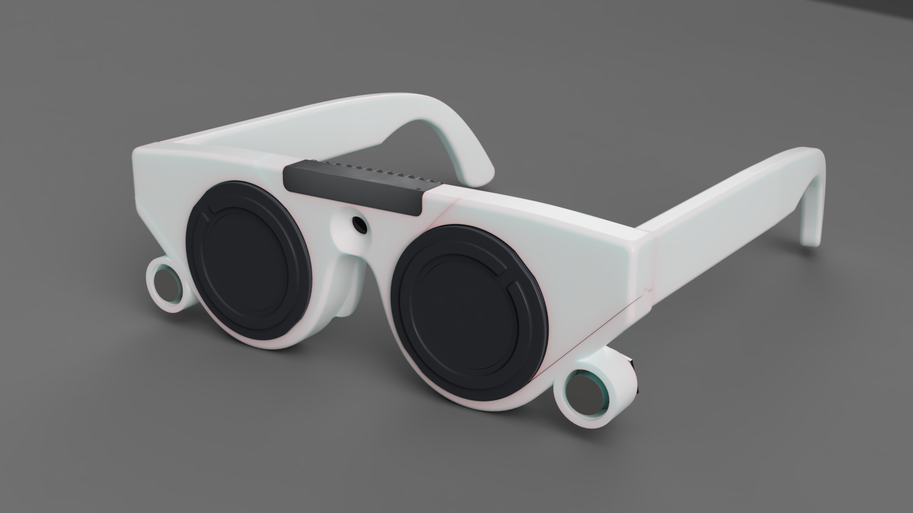
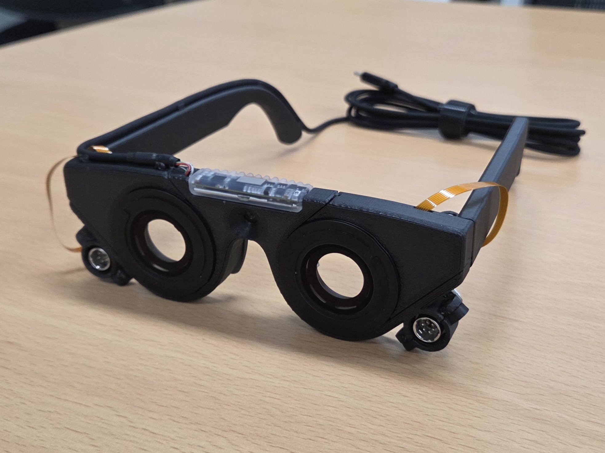
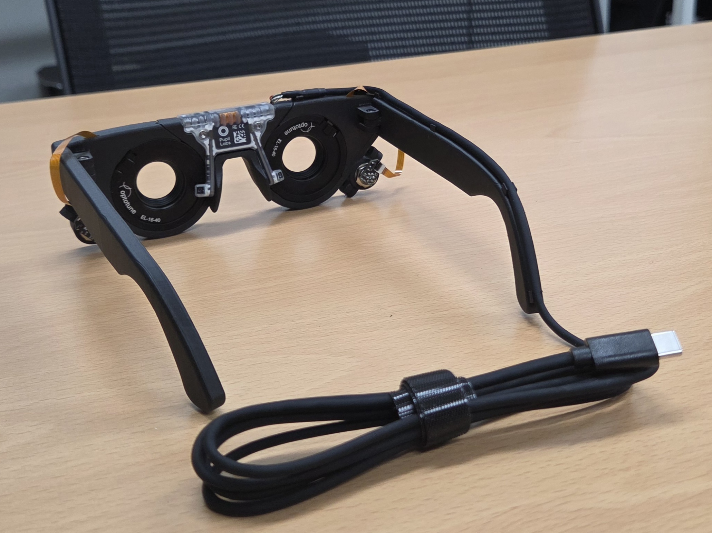
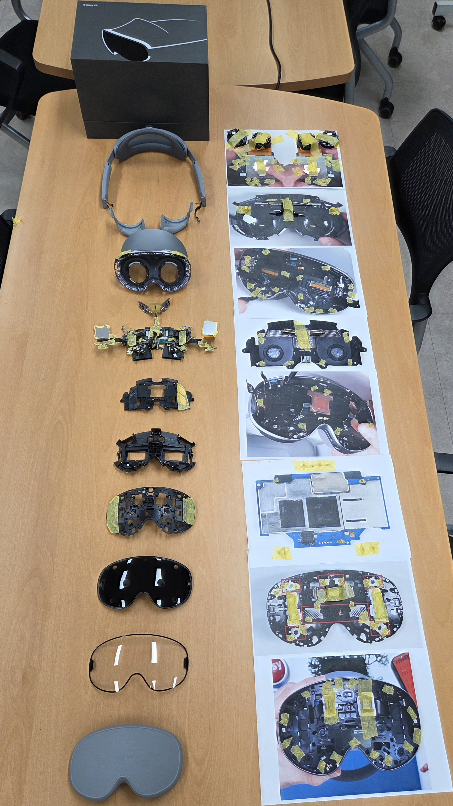
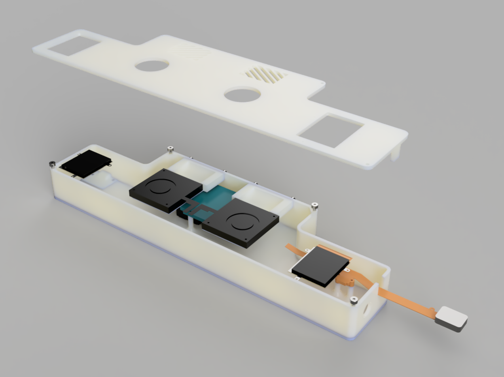
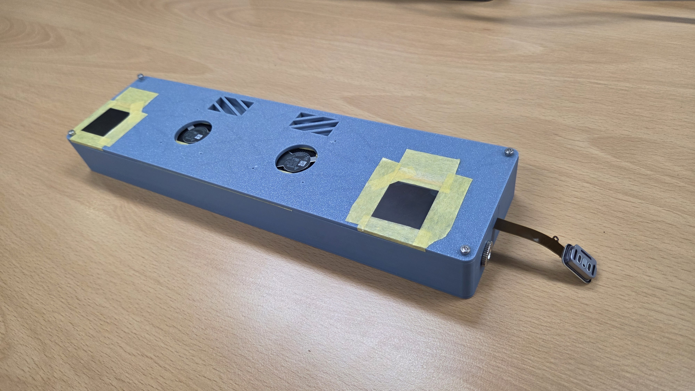

## 1. 프로젝트 개요
이 문서는 2026년에 [집적 광자 소자 및 시스템 연구실](https://ipds.korea.ac.kr) 소속으로 참여한 산업통상자원부의 산업기술 알키미스트 프로젝트의 활동 내용을 기록합니다.

주요 목표는 자동초점조절안경과 AR글래스를 설계하고 테스트하는 것이었습니다.  
이 프로젝트는 도전적이고 혁신적인 산업원천기술 확보에 중점을 두었습니다.

## 2. 주요 주제
### 자동초점조절안경
[Pupil Labs NEON](https://pupil-labs.com/products/neon) + [Optotune EL-16-40](https://www.optotune.com/product/el-16-40-tc/) 기반 전자식 자동 초점 조절 안경

#### 사진
##### 렌더링

##### 시제품

#### 시스템 작동 흐름
Pupil Labs NEON
 
→ 삼성 갤럭시 S25
 
→ Neon Companion 앱
 
→ 시선 추적 및 시선 위치 추정
 
→ 장면 카메라 영상 내 시선 좌표 매핑
 
→ 양자화된 [Depth Anything v3](https://github.com/bytedance-seed/depth-anything-3) 모델
 
→ 깊이 및 대상 거리 추정
 
→ 시선 위치 기준 대상 거리 추출
 
→ Python 기반 통합 및 제어
 
→ 거리-디옵터 변환
 
→ 필요 렌즈 구동 전류 계산
 
→ Optotune ICC-4C 컨트롤러 보드
 
→ Optotune EL-16-40 가변 초점 렌즈
 
→ 렌즈 구동 전류 제어
 
→ 광학 파워(디옵터) 조절
 
→ 자동 초점 및 시력 보정

### AR글래스
[갤럭시 XR](https://www.samsung.com/sec/xr/galaxy-xr/galaxy-xr) 기반 Optical see-through AR글래스

#### 사진
#### 갤럭시 XR 분해도

#### 테스트 벤치 렌더링

#### 테스트 벤치 시제품

## 3. 수행 역할
- 테스트 회로 설계
- 테스트 회로 구성
- 상용 제품 분해
- 시제품 설계
- 시제품 제작
- 프로그래밍
- 시제품 테스트
- 시제품 회로 수리
